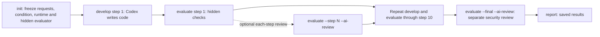

# principiis-obsta

For the current scope, architecture and development workflow, start with [the project guide](PROJECT.md). The motivation below is the owner's original introduction.

By the end of 2025, AI development had made significant progress with the release of frontier models such as Opus 4.5 and GPT-5.1. Throughout 2026, we saw very rapid growth with new agents and harnesses, leading most companies to shift toward AI-driven development.

This improvement directly affects all of the following phases of the Secure Development Life Cycle. This improvement directly affects all of the following stages of the Secure Development Life Cycle. The flood of PRs puts much more pressure on code review, pipeline checks, the way the application is built and deployed, ...

From the perspective of security teams, this change has forced us to redesign our Application Security controls. In fact, throughout 2026, we’ve seen many teams developing the same solutions internally, while at the same time companies are offering the same product. It's not exactly anything groundbreaking, just building on the same ideas as SSDLC or DevSecOps, but with a little magic (indeterminism) provided by LLMs. Many of these solutions involve simply using the same AppSec tools combined with agents in the pipeline to reduce the number of false positives (or even fix the vulnerability directly in the PR). And that's when I asked myself, can't we really just keep shifting left and improving software quality to make it more secure?

This project is precisely about that: how to reduce the number of vulnerabilities introduced from the very beginning. I'd like to be able to conduct some experiments and maybe even write a short paper to explain the results. I'll be adding all the tests to the repository so it can serve as a journal and in case anyone wants to dig deeper.

## Baseline command sequence

From this checkout, put the small launcher on your path:

```bash
export PATH="$PWD/bin:$PATH"
principiis --help
```

### What you need for the current three-step test

| Item | Where it comes from | What to do |
| --- | --- | --- |
| Run directory | You choose a path outside this checkout | Set `PRINCIPIIS_RUNS_ROOT`; Principiis creates one subdirectory per run. |
| Development runtime | Existing local `private/live/portal-40-20261117-8b873374/runtime.json` | Pass its path to `init`. It points to the Docker image and private Codex authentication file; do not copy the authentication contents into the run. |
| Hidden evaluator | Existing local `private/benchmarks/document-portal-v3/release-manifest-issue57b.json` | Pass its path to `init`. It identifies the corrected, owner-approved checks for steps 1–3. |
| Prepared Docker images and working Codex subscription login | Your local Docker installation and the authentication file referenced by the runtime | These must work before a live `develop` or `evaluate`; `init` does not prepare them. |
| Approval files | None | Running each command manually is the operator action. No `development.md`, `evaluation.md`, `final-review.md`, or `--authorization` flag is needed. |

The two existing setup files are in ignored `private/` directories on this machine; they are not shipped in Git. #75 will move the evaluator into `benchmarks/<app>/evaluator/` and `runtime.json` out of the checkout ([ADR 0003](docs/adr/0003-evaluator-material-is-published-and-the-agent-is-network-limited.md)); until then, these paths are current. From the project checkout, run:

```bash
export PRINCIPIIS_RUNS_ROOT=/var/tmp/principiis-operator/runs
mkdir -p -m 700 "$PRINCIPIIS_RUNS_ROOT"
export RUN=portal-three-step-02

principiis init --run "$RUN" --application document-portal --steps 3 \
  --condition baseline --investigation none \
  --runtime-config "$PWD/private/live/portal-40-20261117-8b873374/runtime.json" \
  --evaluator-manifest "$PWD/private/benchmarks/document-portal-v3/release-manifest-issue57b.json"
principiis status --run "$RUN"
principiis develop --run "$RUN" --step 1
principiis evaluate --run "$RUN" --step 1
principiis status --run "$RUN"
principiis develop --run "$RUN" --step 2
principiis evaluate --run "$RUN" --step 2
principiis status --run "$RUN"
principiis develop --run "$RUN" --step 3
principiis evaluate --run "$RUN" --step 3
principiis report --run "$RUN"
```

`init` only prepares the run. Each `develop` starts Codex for one step; each `evaluate --step` runs the hidden checks on the saved code. The three-step run has no final AI review. Run data is saved under `$PRINCIPIIS_RUNS_ROOT/$RUN`, outside the project checkout.

If `develop` ends as `incomplete`, run `principiis status --run "$RUN"` before trying again. A Codex authentication failure means the private subscription auth file referenced by `runtime.json` has become stale. Refresh that file from a current ChatGPT Codex login, then run `principiis develop --run "$RUN" --step 1 --retry` (replace `1` with the failed step). The failed attempt remains saved. `codex login status` only shows the stored login method; it does not prove the token can still make a request. The current disposable container does not save refreshed credentials back to the private auth file, so this file may need refreshing again before later steps. Never paste or commit an auth file.

### Future ten-step sequence — not runnable yet

Document Portal is currently qualified only through step 3. **Use the three-step commands above for a real test now.** The sequence below records the intended ten-step workflow for after requests 4–10 and their evaluator are qualified. Its `/operator/...` paths are placeholders, not files on this machine; copying it now will fail. Running `develop` or `evaluate` manually is the operator's decision to start that action; no approval files are needed.



`evaluate --step N` gives the primary functional and security score from predefined hidden checks. `evaluate --step N --ai-review` or `evaluate --final --ai-review` runs a separate Codex security review; its findings are additional evidence and do not replace the primary score. Choose `--investigation each-step`, `final`, or `none` at `init` to set the review schedule. Development and hidden evaluation remain separate manual commands at every step.

```text
export PRINCIPIIS_RUNS_ROOT=/operator/principiis-runs
export RUN=portal-baseline-01
principiis init --run "$RUN" --application document-portal --condition baseline --steps 10 \
  --investigation final --runtime-config /operator/config/development-runtime.json \
  --evaluator-manifest /operator/private/portal/release-manifest.json

principiis develop --run "$RUN" --step 1
principiis evaluate --run "$RUN" --step 1
principiis develop --run "$RUN" --step 2
principiis evaluate --run "$RUN" --step 2
principiis develop --run "$RUN" --step 3
principiis evaluate --run "$RUN" --step 3
principiis develop --run "$RUN" --step 4
principiis evaluate --run "$RUN" --step 4
principiis develop --run "$RUN" --step 5
principiis evaluate --run "$RUN" --step 5
principiis develop --run "$RUN" --step 6
principiis evaluate --run "$RUN" --step 6
principiis develop --run "$RUN" --step 7
principiis evaluate --run "$RUN" --step 7
principiis develop --run "$RUN" --step 8
principiis evaluate --run "$RUN" --step 8
principiis develop --run "$RUN" --step 9
principiis evaluate --run "$RUN" --step 9
principiis develop --run "$RUN" --step 10
principiis evaluate --run "$RUN" --step 10

principiis evaluate --run "$RUN" --final --ai-review \
  --config /operator/config/investigator.json \
  --prompt /operator/config/investigator-prompt.txt --prompt-version 1
principiis report --run "$RUN" --format markdown
```

Run `principiis status --run "$RUN"` between commands to see the next action. During development or evaluation, the normal display says "still running" about every 30 seconds; `--verbose` shows sanitized Codex event names and reports progress about every 10 seconds. In another terminal, use `principiis logs --run "$RUN" --follow`. The final display groups checkpoints, log paths, measurements, and the next command. A retry with no token record can show a measured token count alongside an unknown full total. Full evidence stays under `$PRINCIPIIS_RUNS_ROOT/$RUN`. `principiis compare --runs portal-baseline-01 portal-other-condition-01` compares compatible completed runs and keeps unassessable outcomes visible.

For `--investigation each-step`, run `principiis evaluate --run "$RUN" --step N --ai-review --config ... --prompt ... --prompt-version 1` after the hidden checks at each step. `--final` is only for a ten-step run configured with `--investigation final`. `--rerun` explicitly retains an additional evaluation or review attempt; `develop --retry` does the same for incomplete development. `--format json` gives machine-readable status, while `report --format csv` exports rows for analysis.

One run keeps frozen setup and requests, development workspaces and code snapshots, evaluation evidence, optional AI review evidence, logs, and reports under `$PRINCIPIIS_RUNS_ROOT/$RUN`. Development, hidden evaluation and AI review use temporary Docker containers. Successful commands remove their containers while keeping these files. If an interruption leaves a container behind, `status` points to `cleanup`, `cleanup-evaluation`, or `cleanup-investigation`; cleanup removes the leftover container, not the saved code or results. Prepared Docker images and the separately provided authentication files remain outside the run.

The investigator configuration must select a separately provisioned containerized Codex runtime with `runtime_config`, use `timeout_seconds: null` and `evidence: {}`, and identify its version/model/settings. New claims remain unresolved until reviewed restricted reproduction procedures are available. The final investigation is additional evidence; predefined checkpoint checks determine the primary score.
