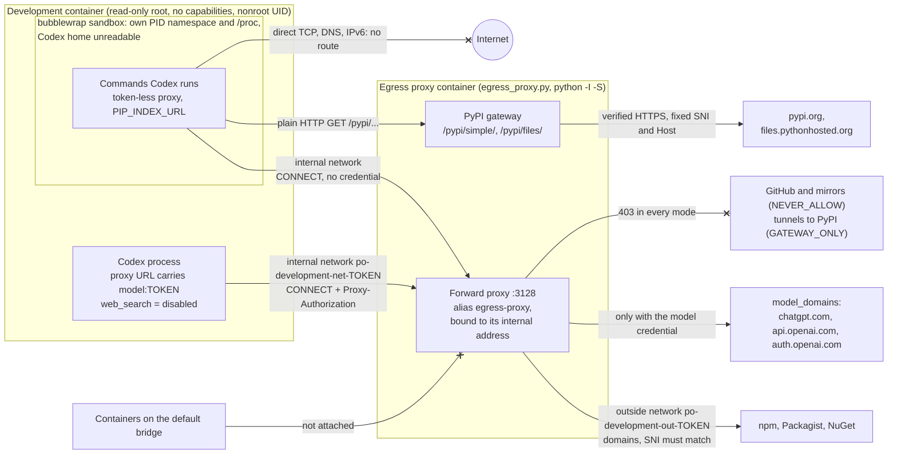

# Network sandbox for the evaluated coding agent (#75)

This note explains how the evaluated coding agent is kept away from GitHub and from
hosted web search while it develops. It is written for a researcher or reviewer who
knows Docker but not this repository. The operator reference, with every verification
record, is [DEVELOPMENT_RUNTIME.md](DEVELOPMENT_RUNTIME.md#network-limits-75); the
decisions are in [ADR 0003](../adr/0003-evaluator-material-is-published-and-the-agent-is-network-limited.md)
and [ADR 0004](../adr/0004-command-egress-pypi-gateway-codex-only-model-credential-docker-desktop-settings.md).
Terms are defined in [GLOSSARY.md](../../GLOSSARY.md).

Code: [`principiis/egress_proxy.py`](../../principiis/egress_proxy.py) (the proxy),
[`principiis/development_runtime.py`](../../principiis/development_runtime.py) (containers,
networks, Codex settings), [`principiis/network_measurement.py`](../../principiis/network_measurement.py)
(measurement, preflight, fronting check) and
[`fixtures/development/network_allowlist.json`](../../fixtures/development/network_allowlist.json).

## The threat

Every benchmark request is in this public repository, and under ADR 0003 the hidden
tests and controls will be published here too. A coding agent with ordinary network
access could therefore:

- fetch a later request, a hidden check or a control result from GitHub (the web UI,
  the API, `raw.githubusercontent.com`, a clone) or from a service that mirrors public
  repositories (Go module proxies, jsDelivr, GitLab, archive.org, ...);
- ask a hosted web search for them, either through Codex's own `web_search` tool or by
  calling the model API itself from a shell command with search turned on;
- read research-side Git history if a workspace pointed at it.

Any of these would let the agent see what it is scored on, so a step's result would no
longer measure the condition. ADR 0003 makes the network limits a precondition for
publishing the tests: until they hold, the tests stay out of public Git.

Two different actors run inside the development container, and the design treats them
differently:

- the **Codex process**, which must talk to the model provider (OpenAI/ChatGPT);
- the **commands** Codex runs (shell, package managers, scripts the agent writes), which
  need package registries but never the model API.

## The layers



### 1. An internal network with no route out

Each attempt creates its own Docker network `po-development-net-<token>` with
`--internal --ipv6=false`; the controller inspects it and refuses to continue unless
Docker reports `Internal: true` and `EnableIPv6: false` (`DevelopmentRuntime.start_egress`).
The development container joins only that network. Direct TCP, UDP and IPv6 have no
route, and Docker's embedded DNS on an internal network resolves no external name, so a
tool that ignores the proxy variables fails closed instead of leaking.

### 2. A per-run egress proxy on its own outside network

The only way out is a trusted proxy container that runs the standard-library program
`egress_proxy.py` (`python -I -S`) from the same pinned image, with no mounts, no login
and the usual restrictions. Its start order matters:

1. it starts on the internal network alone, with `--network-alias egress-proxy`;
2. it binds its listener to its own address there (`own-address`), and the controller
   compares the proxy's `listening` log line with Docker's view of that address;
3. only then does it join its own per-run outside network `po-development-out-<token>`.

It never joins the default bridge, so other containers on the host cannot use it, and a
container on the outside network cannot reach the listener either (it is not bound
there). Commands and Codex name the proxy by the alias `egress-proxy`, which exists only
on the internal network; this keeps the environment, and lockfiles that record the
index URL (`uv.lock`, `poetry.lock`), identical across attempts.

### 3. What the proxy forwards

The proxy runs in one of two modes: `allowlist` for every development run, `log` only
for the one-off measurement that builds the allowlist (section 9). In `allowlist` mode
it checks four host lists, all in `egress_proxy.py` or the allowlist file:

| List | Where | Effect |
| --- | --- | --- |
| `domains` | `network_allowlist.json` | Forwarded on ports 80 and 443 to anyone. Currently `registry.npmjs.org`, `repo.packagist.org`, `packagist.org`, `api.nuget.org` (provisional until the measurement). |
| `model_domains` | `network_allowlist.json` | `api.openai.com`, `auth.openai.com`, `chatgpt.com`: forwarded only with the per-run model credential (section 6). |
| `NEVER_ALLOW` | `egress_proxy.py` | GitHub (`github.com`, `githubusercontent.com`, `github.io`, `ghcr.io`, ...), Go module proxies, jsDelivr, githack, esm.sh, GitLab, Bitbucket, Codeberg, Gitee, archive.org, Software Heritage and similar. Refused in every mode, with or without the credential. |
| `GATEWAY_ONLY` | `egress_proxy.py` | `pypi.org`, `pythonhosted.org`: never tunnelled; reached only through the PyPI gateway (section 5). |
| `MODEL_PROVIDER` | `egress_proxy.py` | `openai.com`, `chatgpt.com`, `chat.com`, `oaistatic.com`, `oaiusercontent.com`: any host under them needs the model credential in both modes. |

`load_allowlist` refuses an allowlist that lists a `NEVER_ALLOW`, `GATEWAY_ONLY` or
model-provider host in `domains` (or a wildcard covering one), a bare `*`, a wildcard
with fewer than two labels after `*.`, an IP literal, or any leftover `TODO` marker.
The proxy applies the same checks again, so a hand-edited file cannot widen it.
`allowlist` mode is default-deny: anything not listed gets `403`.

### 4. Domain fronting checks: SNI and Host

HTTPS goes through `CONNECT`, so the proxy sees the host name but not the path. A
client could still name an allowed host in `CONNECT` and then ask for another one. The
proxy closes the two routes it can see:

- **SNI must match.** After answering `200` to a `CONNECT`, the proxy parses the
  client's TLS ClientHello and forwards it only if its server name equals the `CONNECT`
  host. No SNI, another SNI, Encrypted Client Hello and non-TLS bytes close the tunnel
  before any byte reaches the server (`no-sni`, `sni-mismatch`, `ech`, `not-tls`). This
  holds for the credentialed model tunnel too.
- **Plain HTTP `Host` must match.** A plain-HTTP request is forwarded only with exactly
  one `Host` header naming the request-line host and port, no `Transfer-Encoding`, and
  one request per connection; otherwise `403` (`host-mismatch`, `unsupported-body`).
  `Proxy-*` headers are never forwarded.

What it cannot see is the HTTP `Host` header inside TLS. A host that shares a CDN with
GitHub can therefore serve GitHub content through a tunnel addressed to itself, if the
CDN routes by `Host`. That is how PyPI reached GitHub (see the table below), and why
every `domains` host must pass the fronting check before it is allowed.

### 5. The PyPI gateway

`pypi.org` and `files.pythonhosted.org` are on Fastly with `raw.githubusercontent.com`,
and a tunnel to `pypi.org` with `Host: raw.githubusercontent.com` inside TLS returned
this repository's README. Python packages are still needed, so instead of a tunnel the
proxy serves a read-only PyPI index on the same port, over plain HTTP, on the internal
network only:

- `GET /pypi/simple/<project>/` → `https://pypi.org/simple/<normalised project>/`;
  `GET /pypi/files/packages/<2 hex>/<2 hex>/<60 hex>/<file>` →
  `https://files.pythonhosted.org/packages/...`. Anything else (other methods or paths,
  `..`, percent-encoding, query strings, bodies) gets `403` and never reaches upstream.
- The proxy makes the upstream request itself, with certificate and host-name
  verification, SNI and `Host` fixed to the real host, and a fixed header set; no client
  header is forwarded. Redirects, unexpected statuses or content types, and any answer
  with `X-GitHub-Request-Id` get `502`.
- Index pages are rewritten so file URLs point back at `/pypi/files/`, keeping their
  `sha256` hashes, so pip still verifies every file.

Commands get `PIP_INDEX_URL` and `UV_DEFAULT_INDEX` set to
`http://egress-proxy:3128/pypi/simple/` (plus `PIP_TRUSTED_HOST`, `UV_CACHE_DIR`,
`UV_LINK_MODE`, `NO_PROXY`). pip and uv work with these alone; Poetry ignores them and
fails closed until the gateway is added as its primary source. The alternatives, and why
they were not chosen, are in ADR 0004.

### 6. A model credential that only the Codex process holds

Codex needs the model hosts; the commands it runs must not have them, because a command
could call the model API with hosted web search turned on and bypass every other limit.
The proxy forwards model hosts only for requests carrying
`Proxy-Authorization: Basic base64("model:<token>")`, compared with
`hmac.compare_digest`. The token is drawn with `secrets` for each attempt. Getting it to
the Codex process and nowhere else takes several pieces:

- **Handover by name.** The controller passes `--env PO_MODEL_TOKEN` to the proxy and the
  development container, so Docker reads the value from the controller's environment and
  it never appears on a command line, in a log, in evidence or in `runtime.json`. The
  proxy removes it from its environment, never logs it (`credential` is logged only as
  `valid`, `invalid` or `absent`) and strips `Proxy-*` headers upstream.
- **Only the Codex process gets the credentialed URL.** The container's boot script
  (`MODEL_PROXY_BOOT`) builds `HTTPS_PROXY=http://model:<token>@egress-proxy:3128` (and the
  other three proxy variables), unsets `PO_MODEL_TOKEN` and `exec`s Codex.
- **Commands get the token-less proxy.** Codex is started with
  `shell_environment_policy.set` (token-less proxy variables and the gateway variables)
  and `shell_environment_policy.exclude=["PO_MODEL_TOKEN"]`.
- **Commands cannot see the Codex process.** Codex 0.169.0 runs each command under
  bubblewrap with `--unshare-pid` and a fresh `/proc`, so a command sees only the sandbox
  helper and itself, not the Codex process's `/proc/<pid>/environ`.
- **Commands cannot read the Codex home.** The `development` permission profile sets
  `permissions.development.filesystem={"/home/developer/.codex"="none"}`. That
  directory holds the login and Codex's shell snapshots; the denial was added after a
  shell snapshot was found to contain the credentialed proxy URL (see the table).
- **Checked on every run.** The model-free preflight passes a stand-in token exactly as
  an attempt does, and its probe (`SANDBOX_PROBE`), run as a Codex command, requires no
  `PO_MODEL_TOKEN`, no credential in any proxy variable, no `://model:` in any visible
  `/proc/*/environ`, and `PermissionError` for the Codex home and its `auth.json`.

### 7. Codex's own web search is disabled

Codex is started with `web_search = "disabled"` (`WEB_SEARCH` in
`development_runtime.py`). Hosted search runs on the provider's side and ignores every
network limit above, so this setting is the only barrier against the Codex process
itself searching; it is part of `runtime_version`, so a run cannot continue with a
different value.

### 8. No foreign Git history

Before an attempt starts, `forbid_foreign_git` (`principiis/snapshot.py`) rejects any
`.git` in the workspace that is a symlink, a gitfile pointing elsewhere, or a repository
with `commondir` or `objects/info/alternates`. A self-contained repository the agent
created itself is allowed. Step 1 starts empty and later steps start from the agent's
own previous snapshot, and only the workspace and the login file are mounted.

### 9. Log mode for the measurement, and what it still refuses

The allowlist must be built from what Codex actually needs, so one measurement session
runs on a disposable fixture request with the proxy in `log` mode: it forwards and
records every destination, on any port, with the SNI it saw and whether a credential
came. Even there it refuses, and logs with a reason:

- `NEVER_ALLOW` hosts (GitHub and its mirrors);
- tunnels or plain HTTP to the `GATEWAY_ONLY` PyPI hosts (the gateway serves as usual);
- names that resolve to any non-public address (loopback, RFC 1918, link-local, cloud
  metadata `169.254.169.254`, CGNAT, IPv6 ULA, IPv4-mapped and shorthand forms such as
  `2130706433`, `localhost`, `host.docker.internal`, the proxy's own name and address).
  The proxy resolves once, requires every address to be public, and connects to the
  address it checked;
- model-provider hosts without the model credential, a tunnel whose SNI names one, and
  plain HTTP whose `Host` names one;
- Encrypted Client Hello.

Other SNI mismatches are only recorded in `log` mode. `draft-allowlist` never drafts a
refused, never-allowed or gateway-only host, puts every model-provider or credentialed
host in a separate `model_domains_measured` list, and writes a draft with `TODO` markers
that the runtime refuses until the owner has reviewed it.

## Attacks we tried

All of these are model-free and use real Docker. "Egress", "Model token" and "Runtime"
name the opt-in controls `tests/test_egress_containers.py`,
`tests/test_model_token_containers.py` and `tests/test_development_runtime_containers.py`.
Dated results are in [DEVELOPMENT_RUNTIME.md](DEVELOPMENT_RUNTIME.md#what-is-verified-and-what-is-not).

| Route to GitHub or the model | How it was tested | Result |
| --- | --- | --- |
| Bypass the proxy: direct TCP to `1.1.1.1` and GitHub's address, TCP over IPv6, DNS for `pypi.org` and `github.com` | Egress `test_network_is_internal_without_ipv6_and_a_client_without_the_proxy_has_no_route` | All fail; no global IPv6 address. |
| Resolve external names through the proxy alias network | Egress `test_the_proxy_alias_resolves_on_the_internal_network_only_and_external_names_do_not` | `egress-proxy` resolves on the internal network only; `pypi.org`, `github.com`, `chatgpt.com` do not resolve. |
| Use the proxy from another container (default bridge, outside network) | Egress `test_the_proxy_is_on_its_own_networks_only_and_listens_only_on_its_internal_address` | Both fail to connect. |
| `CONNECT` to GitHub hosts, GitHub's IP, other ports, loopback, private and metadata addresses | Egress `test_allowed_hosts_connect_and_everything_else_is_refused` | `403`, logged as `refused`. |
| SNI fronting: tunnel to `registry.npmjs.org` or `api.nuget.org` with SNI `raw.githubusercontent.com` or `github.com` | Egress `test_tls_to_an_allowed_host_works_only_with_its_own_server_name` | Tunnel closed before any byte reaches the server (`sni-mismatch`). |
| Plain-HTTP Host fronting: request to an allowed host with `Host: raw.githubusercontent.com` | Egress `test_plain_http_with_a_foreign_host_header_is_refused` | `403` (`host-mismatch`). |
| **Host fronting inside TLS through PyPI** (Fastly): tunnel to `pypi.org`, SNI `pypi.org`, `GET /SrFlipFlop/principiis-obsta/main/README.md` with `Host: raw.githubusercontent.com` | Real-Docker probe on 2026-11-27, then Egress `test_host_header_fronting_through_pypi_is_closed_because_pypi_is_never_tunnelled` | **Found:** `200` with this repository's `README.md`, `X-GitHub-Request-Id` and `Via: 1.1 varnish`. **Now:** PyPI is gateway-only; the `CONNECT` gets `403` (`gateway-only host`). |
| The same Host fronting through every remaining `domains` host | Egress `test_no_allowlisted_domain_fronts_github`; `network_measurement fronting-check` | No GitHub content: `registry.npmjs.org` (Cloudflare) `403`, `repo.packagist.org` and `packagist.org` (BunnyCDN) `403`, `api.nuget.org` `421`. A positive control through an old proxy that still tunnelled PyPI flagged both PyPI hosts as `FAIL`, so the probe detects fronting. |
| Path and header tricks through the PyPI gateway (`..`, `%2e%2e`, the bare README path, query strings, JSON API, `POST`, `HEAD`, absolute-form to GitHub) | Egress `test_the_pypi_gateway_serves_pypi_and_refuses_everything_else` | `403`, never GitHub content; the log holds no path, query or project name. |
| A command calls the model API (where hosted search would be available) | Model token `test_commands_get_403_for_model_hosts_and_cannot_recover_the_token`, `test_commands_run_by_codex_exec_get_the_token_less_proxy` | `403` for `chatgpt.com`, `api.openai.com`, `auth.openai.com` (`model host without the model credential`). |
| A command recovers the token: environment, `/proc/*/environ`, files under `/home`, `/tmp`, `/run`, `/workspace`, `/etc`, the Codex home | Same Model token controls; preflight `SANDBOX_PROBE` | Only PIDs 1 and 2 visible, no token anywhere, `auth.json` raises `PermissionError`. **Found before the fix:** with a stand-in model, a command inherited the credentialed proxy URL, and Codex's shell snapshot under `$CODEX_HOME/shell_snapshots/` contained it. Fixed by `shell_environment_policy` and the Codex-home read denial. |
| The Codex process fronts another host through its credentialed model tunnel | Model token `test_the_codex_process_credentialed_tunnel_still_passes_the_sni_check` (sink on the internal network, no way out) | SNI `chatgpt.com` forwarded; SNI `pypi.org` and `raw.githubusercontent.com` closed (`sni-mismatch`, credential `valid`). |
| Real `codex exec` reaches the model hosts only with the credential | Model token `test_codex_exec_presents_the_model_credential_to_a_refusing_proxy` (FAKE login, refuse-everything proxy) | Codex's `chatgpt.com` requests carry `credential: valid`. |
| **Log mode** (measurement): GitHub, PyPI tunnels, private and metadata addresses, model hosts without the credential | Egress `test_log_mode_refuses_github_pypi_tunnels_and_non_public_addresses`; Model token `test_in_log_mode_commands_get_403_for_every_model_provider_host` | All `403` with a reason; only `registry.npmjs.org` connects. **Found before the fix:** the old `log` mode forwarded every destination (its `allowed` returned true for any host in `log` mode), so the same control got `200` for the GitHub `CONNECT`s, and loopback, private and metadata addresses were forwarded too. |

### Other findings

- **Docker Desktop's bubblewrap failure is a kernel rule.** On Docker Desktop the Codex
  sandbox failed with `bwrap: Can't mount proc on /proc: Operation not permitted`. The
  kernel allows a new `proc` mount in an unprivileged user namespace only if the
  existing `/proc` is fully visible; every mount over it is locked when bubblewrap
  enters its user namespace, and any locked mount that hides part of it makes the new
  mount "too revealing" (`EPERM`). Docker's default `/proc` masks are such mounts. This
  was observed on Docker Desktop's LinuxKit kernel; nothing about it is Desktop-specific.
  Without its fresh `/proc` the sandbox would not hide the Codex process from commands,
  so the preflight stops the attempt rather than falling back to Codex's `--no-proc`.
- **The per-attempt proxy address broke lockfiles.** Before the `egress-proxy` alias,
  `uv.lock` recorded the proxy's per-attempt address, so `uv sync --locked` failed in a
  later step. Egress `test_a_uv_lock_from_one_attempt_is_valid_unchanged_with_a_fresh_proxy`
  now shows the same `uv.lock` working behind a fresh proxy.

## Docker Desktop and Linux

The runtime was written for a Linux Docker Engine. On Docker Desktop it works only with
three optional `runtime.json` settings; without them it fails closed in its preflight.
On Linux, leave them out unless the preflight fails in the same way.

| Setting | Default (Linux) | Docker Desktop | Trade-off |
| --- | --- | --- | --- |
| `docker_socket` | `/var/run/docker.sock` | `$HOME/.docker/run/docker.sock` | None for isolation: it must be an existing local Unix socket (no `tcp://`, `ssh://` or other URL), so it can only name a local daemon. `DOCKER_HOST` and Docker contexts are still ignored. Not part of `runtime_version`. |
| `proc` | `docker-default` | `unmasked-for-nested-sandbox` | Adds `--security-opt systempaths=unconfined` only to the containers that run the Codex sandbox (the two preflights and the development container), never to the proxy, probes or loader. Commands see nothing new: inside bubblewrap they already get a fresh, unmasked `/proc`. The outer container newly sees `/proc/interrupts`, `/proc/scsi`, `/proc/keys` (only keys its UID may view; `keyctl` stays denied by seccomp) and `/sys/firmware`. `/proc/kcore` and `/proc/timer_list` stay unreadable, and no file in `/proc/sys` can be written; the Runtime control checks this whenever it runs with the setting. Docker refuses any narrower mount under `/proc`. |
| `workspace_mount` | `bind` | `volume` | Desktop's shared file system made bubblewrap's mounts of protected paths (`.git`, `.agents`, `.codex`) unreliable once the Codex home was denied. With `volume` each attempt copies the workspace into its own Docker volume through a never-started loader container and back after the run, with an extractor that refuses absolute names, `..` and paths under symlinks. The volume has no `nosuid`/`nodev` (no capabilities and `no-new-privileges` still apply). |

`proc` and `workspace_mount` are part of `runtime_version` (`docker_host`), so a run
cannot switch settings halfway. Preview, restricted evaluation and evaluation cleanup do
not read these settings yet.

## What is still open

From the Known gaps list in [DEVELOPMENT_RUNTIME.md](DEVELOPMENT_RUNTIME.md#what-is-verified-and-what-is-not):

- **Real model traffic through the credentialed proxy is unverified end to end.** All
  controls so far used a FAKE login, a stand-in model or a proxy without a way out.
- **The allowlist is a guess** until the measurement has run and the owner has reviewed
  the draft.
- **Model hosts are not fronting-checked.** The OpenAI hosts are on Cloudflare; whether a
  tunnel to them reaches GitHub by Host fronting was not tested, because that needs the
  credential and contacts OpenAI. Only the Codex process can open them.
- **Host fronting to OpenAI inside TLS in `log` mode.** A command could open a tunnel to
  another host on OpenAI's CDN with that host's SNI and send `Host: api.openai.com` inside
  TLS. Whether Cloudflare routes that across zones is untested. The command would still
  have no OpenAI credential. `allowlist` mode is not affected.
- **The Codex process itself still reaches the model hosts.** Its hosted search stays off
  only through `web_search = "disabled"`. The barrier against commands relies on
  bubblewrap's fresh `/proc`.
- **`MODEL_PROVIDER` and `NEVER_ALLOW` are not exhaustive.** `allowlist` mode is
  default-deny regardless.
- **Registries serve anything anyone uploads.** npm and PyPI (including through the
  gateway) could serve this repository's files if someone published them as a package;
  this risk is accepted for now. `proxy.golang.org` is never allowed, so Go module
  downloads fail; Packagist downloads normally come from GitHub, so Composer installs may
  fail too. Composer, .NET and Go installs through the proxy are unverified.
- **Docker Desktop specifics.** Neither host setting has been tried on the owner's Linux
  Docker; whether its nested sandbox gets a fresh `/proc` without `proc` is unverified.
  The Dockerfile's .NET layer is linux-x64 only, and an amd64 image under emulation fails
  the preflight on Apple silicon.
- **Encrypted Client Hello** is refused in both modes, so a client that always offers it
  cannot use the proxy (no client in the image does).
- **`apply_patch` under the Codex-home denial** is unverified.

## Live measurement (2026-11-28)

Results are recorded in [DEVELOPMENT_RUNTIME.md](DEVELOPMENT_RUNTIME.md).

## How to verify it yourself

The unit tests need no Docker:

```bash
python3 -m unittest discover -s tests -q
```

The container controls are opt-in. They call no model and mount no real login; the
egress controls need host internet. `IMAGE_ID` is a prepared local development image
(`sha256:...`), `SCRATCH_DIR` a directory the Docker daemon can mount. On a Linux Docker
Engine leave out the last line of variables; `PO_DOCKER` defaults to `/snap/bin/docker`.

```bash
PO_RUNTIME_IMAGE=IMAGE_ID PO_RUNTIME_ROOT=SCRATCH_DIR PO_EGRESS_CONTROL=1 \
PO_DOCKER=PATH_TO_DOCKER_CLI \
PO_DOCKER_SOCKET=$HOME/.docker/run/docker.sock PO_RUNTIME_PROC=unmasked-for-nested-sandbox PO_RUNTIME_WORKSPACE_MOUNT=volume \
    python3 -m unittest discover -s tests -p 'test_*_containers.py'
```

That runs all three controls together. To run one, use `-p test_egress_containers.py`,
`-p test_model_token_containers.py` or `-p test_development_runtime_containers.py`
(the last needs only `PO_RUNTIME_IMAGE` and `PO_RUNTIME_ROOT`). The egress control skips
the Codex preflight, so any image with `python` works for it; the other two need the
development image with Codex.

The fronting check probes every `domains` host of an allowlist (draft or shipped) for
Host-header fronting to GitHub. It starts the proxy with no model domains and no token.
Every host must `PASS`:

```bash
python3 -m principiis.network_measurement fronting-check --config RUNTIME_JSON \
    [--allowlist DRAFT_ALLOWLIST.json]
```

The preflight checks a runtime configuration before a live measurement. It starts
nothing that mounts the login, never opens the login file and calls no model:

```bash
python3 -m principiis.network_measurement preflight --config RUNTIME_JSON --runs-root RUNS_ROOT
```

`RUNTIME_JSON` is a development `runtime.json` as described in
[DEVELOPMENT_RUNTIME.md](DEVELOPMENT_RUNTIME.md#docker-host-settings-docker-desktop); keep
it outside the repository. The live measurement itself is a subscription run and needs
the owner's approval (AGENTS.md hard rule 3).
